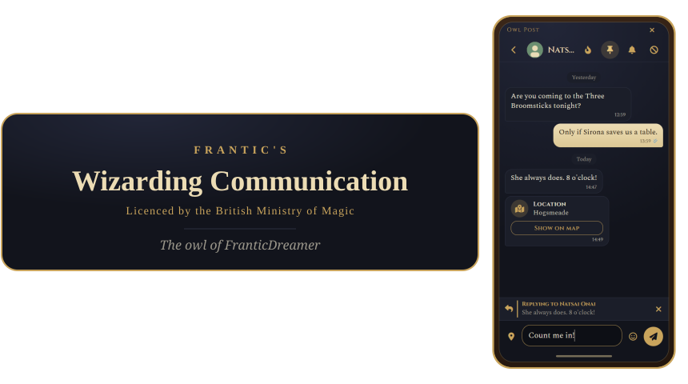

**frantic-owls**: A pseudo-smartphone for HogwartsMP. `/owl` opens it on the right side of the screen.

Servers can pick a second front end instead: **immersive mode**, a letter desk in the middle of the screen where owls are letters written on parchment, read and sent like e-mail. Both keep their owls in the same tables, so a server can switch between them at any time. See [Immersive mode](#immersive-mode).

Based on my private phone resource for FiveM Roleplay Servers. Replaced QB-Core calls with hmp ones and replaced some terminology.

IMPORTANT: For now, calls are disabled by default in the config because they are NOT working since HogwartsMP doesn't expose a direct API for voice manipulation. Check the reasource for updates every now and then so that you can update when the fix comes.

Summary of current capabilities:

- **Contacts**: An alphabetical address book with search. Each contact shows the profile picture that owl chose for themselves. Opening a contact lets you rename them, set a picture override that only you see (any direct image link, GIFs included, e.g. `https://i.imgur.com/abc123.gif`), clear that override again with **Use Their Picture**, star them as a **favourite**, send them an owl, or delete them. Favourites are listed together at the top of Contacts and of every contact picker. On servers with `phonemode_numbers.dialling`, the plus in the header adds a contact by typing in their owl number; see [Owl numbers](#owl-numbers).
- **Owls**: The messaging app. Chats are sorted by their latest owl, with search behind the search icon; **pinned** chats (the pin in a chat's header, up to 5) stay on top. **Send New Owl** (bottom right) picks a contact, or **Bulk Owl** picks several to start a group. Each contact has exactly one chat: Starting a new owl to someone you already talk to opens the existing chat. A bulk owl can be left from the button in its header; the others see a quiet "... left." note, the leaver loses access to its history, and the last one out closes it for good. One-to-one chats cannot be left. Tap an owl to **Reply** to it, **Forward** it, **Pin** it at the top of the chat, **Delete** it from your phone, or **Unsend** one of your own for everyone (see [Owl actions](#owl-actions)). The magnifying glass in a chat's header searches the whole chat; see [Searching a chat](#searching-a-chat). Bulk owls have admins (see [Bulk owl admins](#bulk-owl-admins)) and take [polls](#polls). Beside the message box, the emoji button opens a picker (its last tab remembers the ones you used) and the pin sends where you are standing as a **location owl**; see [Location owls](#location-owls). Whatever is left unsent in a chat's message box stays there as its **draft**, marked "Draft:" in the chat list.
- **Floo-Calls**: The first app on the home screen. Call a contact with the flame in their contact page or a one-to-one chat's header, from the call log, or with **New Floo-Call**. The phone rings for them with the ringtone they picked (and a flickering flame pop-up even while their phone is closed) until they answer, decline or `phonemode_calls.ringSeconds` pass. While a call lasts, going back keeps it; a green timer in the status bar returns to it. Once answered, the two players talk through their microphones, at any distance, with **Mute** and **Hang Up** on the call screen; their voices pass through the server, so neither sees the other's IP address. The app is the call log: Every call made and received, missed calls in red, with a count on the app until you look. See [Floo-Calls](#floo-calls).
- **Inform**: Offer your owl to a player standing nearby. They are asked first and can **Accept** it, **Exchange** (accept it and give you theirs back) or **Decline**; once accepted, you are in their contacts under your character's name. Offers they have not answered wait on their Inform screen (with a count on its tile) for a minute. You can inform the same person once every 30 seconds (configurable); different people have no limit. Servers can turn the asking off, and then informs land straight in the contacts as before.
- **Settings**: Grouped like a phone's Settings app. The first page shows the crest, your card and one row per category, each with what is set:
  - **Profile**: Your own profile picture.
  - **Appearance**: The theme (Muggle Phone, or Parchment, which turns the phone into a sheet of old paper with torn edges), the Muggle Phone's **colour scheme** (Default, or the colours of Gryffindor, Slytherin, Ravenclaw or Hufflepuff) and its **animations** on/off, the **lock screen** on/off, a **wallpaper** for the home screen (any direct image link; only you see it, and on Parchment it is printed faintly onto the paper like an old engraving), and **Move & Resize Owl** (when the server allows it).
  - **Language**: A dropdown, when the server has more than one.
  - **Notifications**: Sound on/off, which sound (a dropdown of Owl Hoot, Bell Chime, Wand Sparkle, Window Tap, Quill Scratch or Enchanted Harp; each plays when picked), its volume and pop-ups on/off, and **Phone sounds** on/off with their own volume.
  - **Floo-Calls**: The ringtone (a dropdown of the server's `phonemode_calls.ringtones`; each plays when picked), its own volume and **Test Ringtone**, and the **call volume** of the other player's voice. The ringtone part shows when the server plays sound files, the call volume when voice is on.
  - **Do Not Disturb**: Do Not Disturb and Quiet during duels.
  - **Privacy & Blocking**: Read receipts and typing indicators on/off, and everyone you blocked.

  In the parchment theme the on/off switches are hand-inked tick boxes.

`/owl_resetpos` puts a moved or resized phone back in its default place and size.

Taking the phone out shows its **lock screen** first: On Muggle Phone a large clock and the date over your wallpaper, with a fingerprint to touch; on Parchment a letter addressed to your character, closed with a wax seal that cracks when you break it, before the flap opens and the letter rises out. Both list your unread owls, missed Floo-Calls and informs waiting for you. Nothing behind the lock counts as seen until it is opened, so a chat left open stays unread. A ringing call takes over the lock, and tapping a banner on it opens the lock too. Players can turn it off in Settings and servers with `phonemode_ui.lockScreen`; passwords are planned.

When an owl arrives while the phone is closed, a small square pops up at the side of the screen for a few seconds and the notification sound plays. While the phone is open, a notification banner drops in from the top instead (tap it to open the chat). Nothing pops up for the chat you are reading; an owl landing there plays a soft **phone sound** instead.

The phone makes small sounds of its own as well, as the Frantic_Phone resource for FiveM did: A tap for each key typed and another for each one erased, a tap when an app opens from the home screen, a click when the phone locks as it is put away and another when it is unlocked, and a sound when an owl you sent takes off or one lands in the chat you are reading. Players turn them off or set their volume in Settings (Notifications); an owl landing keeps quiet under Do Not Disturb, the rest do not, since they answer what the player does. Each theme has its own set: Muggle Phone clicks and chimes like a phone, while Parchment, which should not, is silent for now (its files in `UI/Sounds/Parchment/` are valid but empty, waiting for sounds of its own). Servers pick the files of each theme in `phonemode_effects`.

## Immersive mode

Set `"mode": "immersive"` and players get a writing desk instead of the phone. The desk is its own page (`UI/Immersive.html` with `UI/Scripts/Immersive/` and `UI/Styles/Immersive.css`); the phone's page is never loaded on such a server, and the other way round. Players have their own guide: [PLAYER_GUIDE_IMMERSIVE.md](PLAYER_GUIDE_IMMERSIVE.md).

- **The desk** opens in the middle of the screen over a semi-opaque backdrop, as if the whole screen were the desk. It lists letters like an e-mail inbox: **Letters** (received) and **Sent**, newest first, unread ones under a red wax seal, then **Correspondents** and, for those allowed to announce, **Official Post**.
- **Letters** are written and read on a sheet of parchment (`UI/Textures/MailParchment.png`) in one bundled handwriting font (Caveat). The sheet is laid out at one fixed size and only then scaled to the screen, so a letter breaks its lines in exactly the same places on every player's screen, with its spaces, indents and blank lines kept.
- **Writing**: The greeting ("Dear Ominis and Natsai,") is filled in from the recipients picked right in it, and the sign-off and the writer's name below the body. The quill button (**Edit Whole Letter**) turns all of it into one page of text so the greeting and signature can be reworded or dropped. Either way the database stores the finished letter as one text, nothing else.
- **Recipients** can be any character with an owl, online or not. Typing a name shows one list: the writer's matching **correspondents** first, then every other character by that name, with a dot on those online. A character already among the writer's correspondents is only listed once, as that correspondent. Everyone a character writes to becomes their contact (not the other way round). Under the hood owl numbers still identify everyone; players never see them.
- **Correspondents** is the desk's address book: Star, rename, write to or forget each one, give them a picture where `immersivemode_avatars` allows it, and **Add Correspondent** to save any character by name without writing first.
- **Several recipients** do not make a bulk owl. Each gets a copy of their own, in the one-to-one chat they share with the writer, and answers only to the writer.
- **Anonymity**: Readers are never told who wrote a letter (official senders aside); they see what the letter says, and the list of letters shows its first and last lines (usually the greeting and signature). A writer who drops their name in full edit sends it unsigned. The database still records the sender of every owl, as always, so staff can look it up and the Discord log names them.
- **Answering** a letter names the letter, not its writer: The server works out who wrote it, so an anonymous writer stays anonymous to the one answering. The writer is saved among the answerer's correspondents under the name they signed with, as a correspondent whose identity is unknown: The page gets no owl number, character name or profile picture for them, so it cannot match them to a character found by name. Two gaps remain by design: Adding that same character again by name is refused (without naming the correspondent), and a letter later written to them by name is listed in the sent box under the correspondent's name.
- **Official Post** is for whoever may announce (the same permission as `/owl_announce`, while `announcements.enabled`): They write as the Ministry, or as any other resource's sender that is running, to **Everyone** (an announcement) or to up to 50 characters by name, one copy each. Official letters keep the letter's length and layout, are not tied to owl posts, and are logged under `logging.events.announcements`.
- **Where** letters can be read and written is up to the server (`immersivemode_readmode` and `immersivemode_writemode`, both `"free"` by default):
  - `"free"`: Anywhere.
  - `"postonly"`: Only at an owl post.
  - `"postonly_freeunread"` (reading only): Unread letters anywhere; letters already read only at an owl post.

  The server checks every read and write against where the character stands, and a letter's text never leaves the server while it may not be read there.
- **Owl posts** are listed in `immersivemode_posts` (see `Examples/frantic-owls.immersive.json`; stand where a post should be and use `/owl_posthere <id> [label]` to get its entry, then `/owl_reloadposts` once it is in the file; see [Placing owl posts](#placing-owl-posts)). With **hmp-interact** running each one is an interaction zone ("Use the owl post"), optionally with a prop of your choice, that opens the desk; without it, players open the desk with `/owl` while standing at one.
- **Notices**: While the desk is closed, a slip of parchment drops in at the top of the screen when an owl arrives (and once on loading in, if letters are waiting), with the player's notification sound. Do Not Disturb and Quiet during duels apply as on the phone.
- **Settings** on the desk: Language, the arrival sound and its volume, notices, Do Not Disturb, Quiet during duels and Show original names. They are the same stored settings as the phone's.

Owls from phone mode show as letters too: A bulk owl's owls arrive as letters from their sender (tagged with the bulk owl's name; answering goes to the sender alone), announcements as official letters, and location owls and polls written out in words. Owl flight, blocks, retired characters, announcements, the `api` export, the `frantic-owls:sent` event and Discord logging work as in phone mode.

**Not tried in the game yet.** It was checked against MariaDB and in the browser preview (`Dev/ImmersivePreview.html`).

## Screenshots

All in the Muggle Phone theme with the Default colour scheme, unless named otherwise.

<table>
	<tr>
		<td align="center">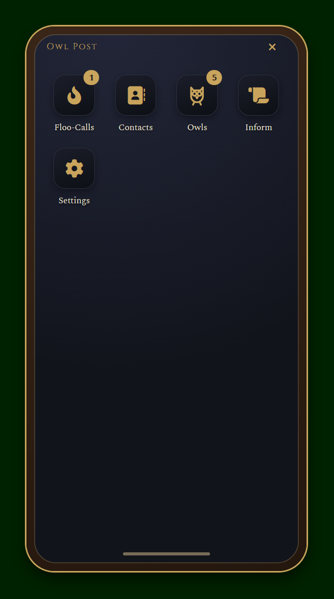</td>
		<td align="center">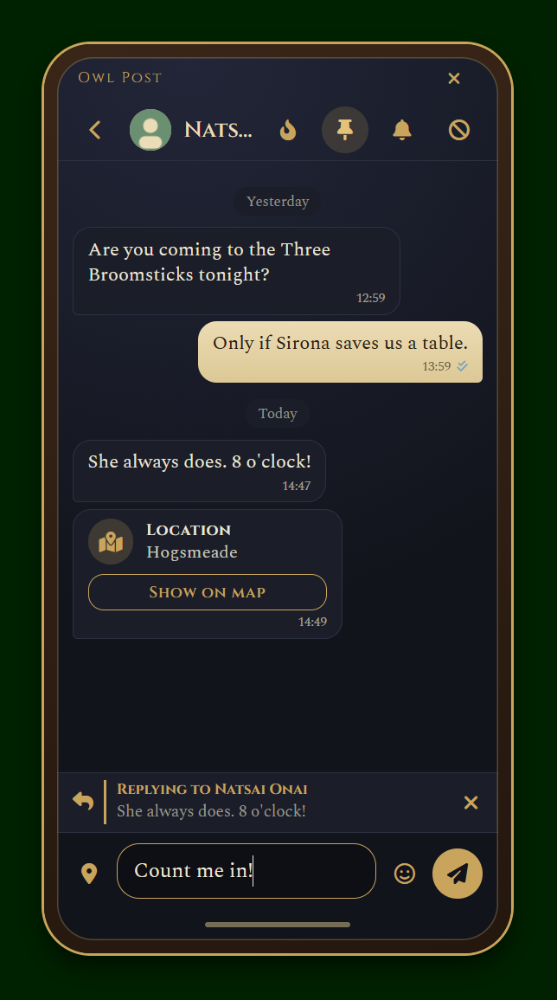</td>
		<td align="center">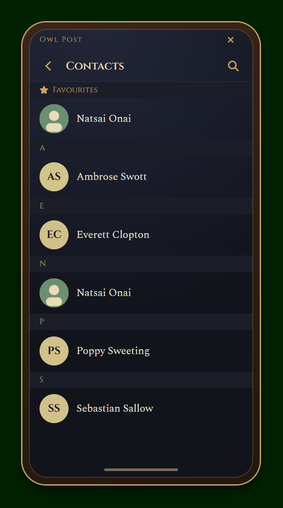</td>
		<td align="center">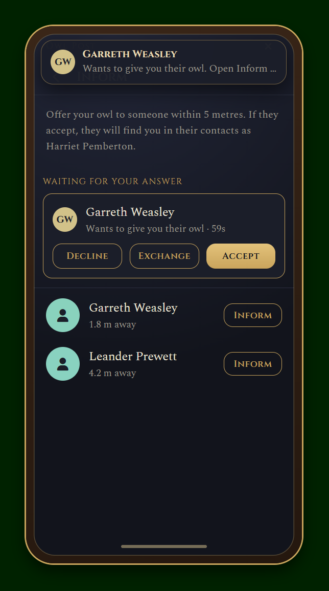</td>
		<td align="center">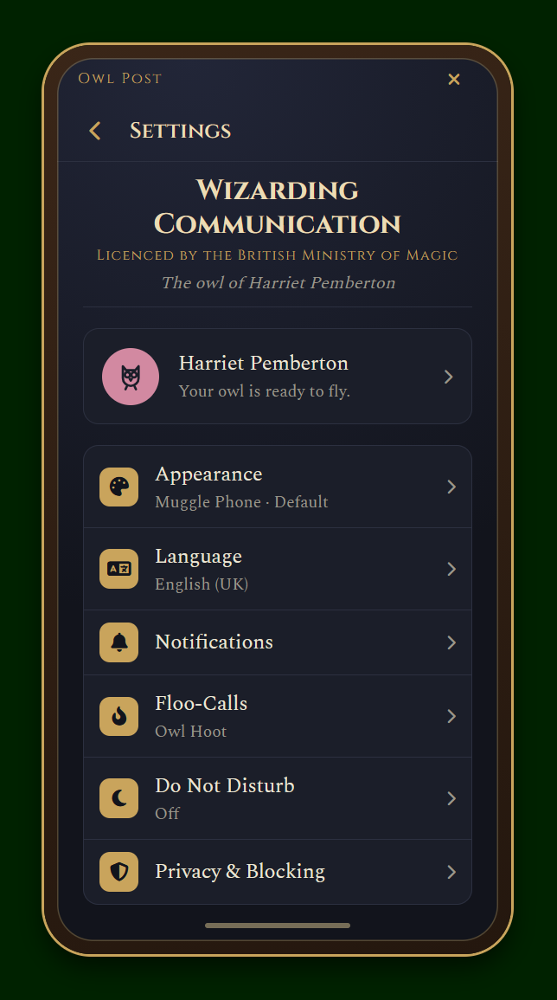</td>
	</tr>
	<tr>
		<td align="center">Home</td>
		<td align="center">Owls</td>
		<td align="center">Contacts</td>
		<td align="center">Inform</td>
		<td align="center">Settings</td>
	</tr>
</table>

### Themes

<table>
	<tr>
		<td align="center"></td>
		<td align="center">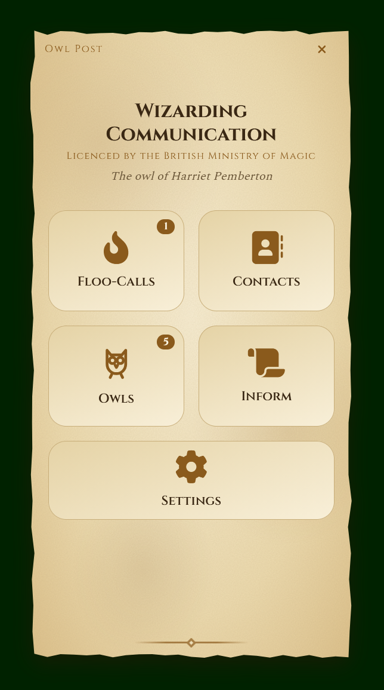</td>
	</tr>
	<tr>
		<td align="center">Muggle Phone</td>
		<td align="center">Parchment</td>
	</tr>
</table>

### Colour schemes

The Muggle Phone's house colour schemes.

<table>
	<tr>
		<td align="center"></td>
		<td align="center">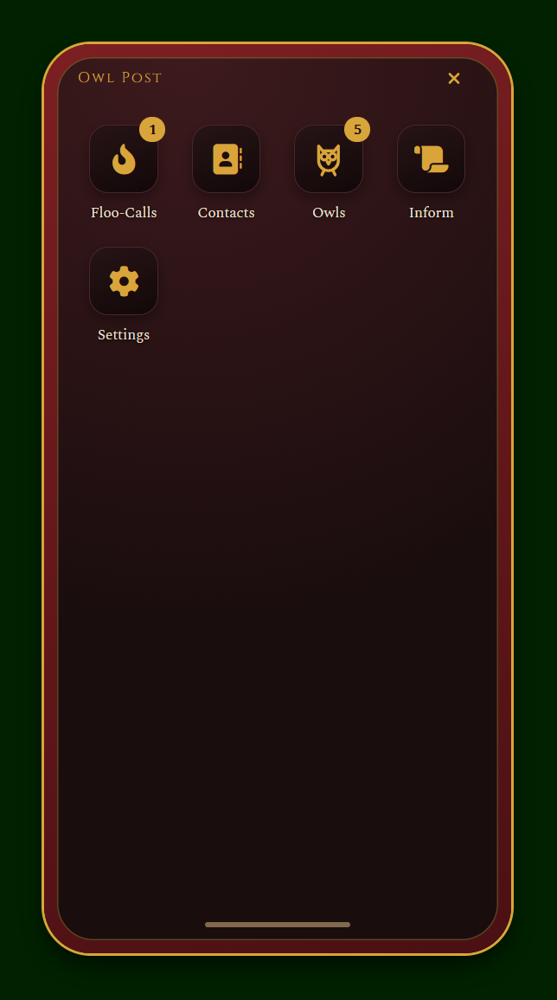</td>
		<td align="center">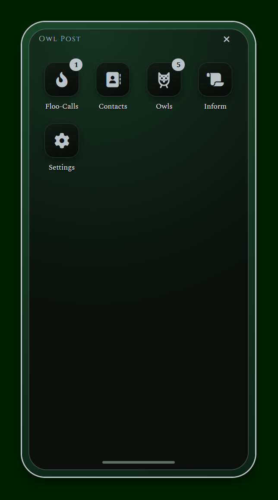</td>
		<td align="center">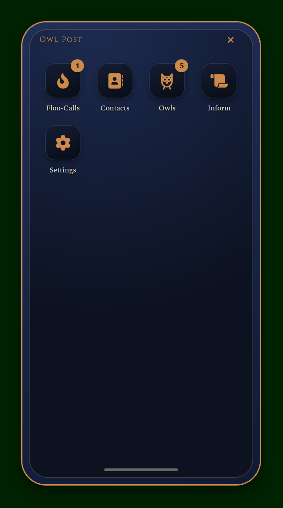</td>
		<td align="center">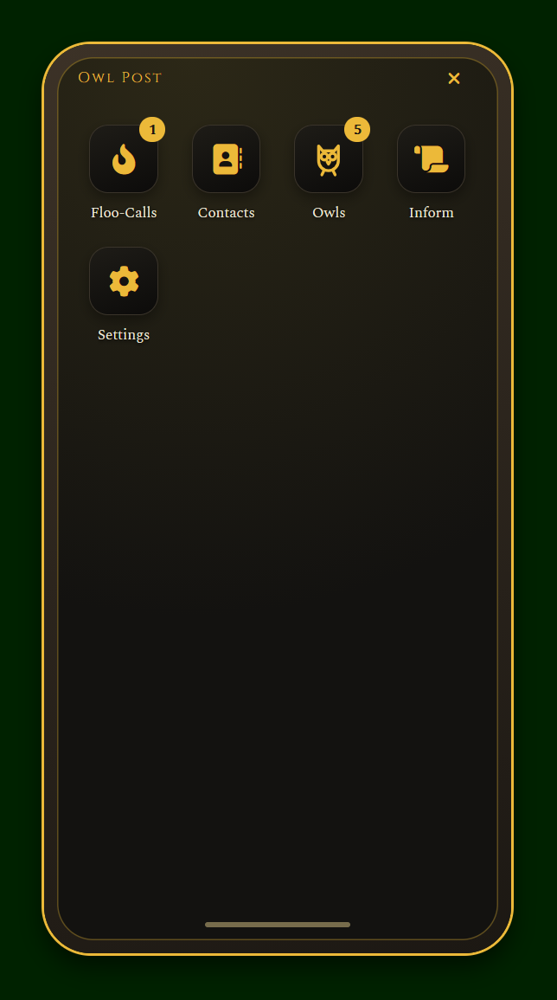</td>
	</tr>
	<tr>
		<td align="center">Hogwarts Legacy (Default)</td>
		<td align="center">Gryffindor</td>
		<td align="center">Slytherin</td>
		<td align="center">Ravenclaw</td>
		<td align="center">Hufflepuff</td>
	</tr>
</table>

## Requirements

- `hmp-lib`, `hmp-mysql` and `hmp-core` (0.9.0).
- Optional: `hmp-admin` (announcement permissions), `hmp-webhooks` (Discord logging through its queue), `hmp-blips` (location markers that survive its map resyncs and wait for readers in another area), `hmp-activities` (Quiet during duels) and `hmp-interact` (owl post prompts in immersive mode).
- A working `hmp-mysql` connection. The tables are created automatically on first start through `hmp-mysql`'s migration ledger.
- A loaded `hmp-core` character: Owls belong to characters, not accounts.

## Installation

1. Make sure the required resources above are installed and `hmp-mysql` can reach your database.
2. Put this folder in the server's `resources` folder as `resources/frantic-owls`. It must sit directly inside `resources`, not in a sub-folder such as `resources/[phone]/frantic-owls`.
3. Optional: Copy `Examples/frantic-owls.json` to the server's `data` folder as `data/frantic-owls.json` and change what you like (see [Configuration](#configuration)). Without it, every setting uses its default. For [immersive mode](#immersive-mode), copy `Examples/frantic-owls.immersive.json` instead: It is a complete configuration for that mode, with every shared setting and every `immersivemode_` one, leaving out the `phonemode_` sections it does not use. Give its example owl post a real position (or remove it).
4. Start the server and join it.
5. Load a character and type `/owl` or use up arrow key.

The console shows `Started JS resource: frantic-owls` when it is running. The database migrations are created on the first start.

## Features

What is in, and what is coming. Not in the Order of Priority.
Most of the future items were present in the FiveM version but are not yet ported over to HogwartsMP.

Want to help with one? See [CONTRIBUTING.md](CONTRIBUTING.md).

✅ = Done  
⏳ = In Progress (Could be on the `dev` branch)  
⚙️ = Testing (Could be on the `test` branch)  
🚧 = Parked/Paused - Requires work on HogwartsMP itself  
⬜ = Not Started  

(I hate emojis but github doesn't support [/] for checkboxes)  

| | Feature |
| --- | --- |
| Contacts: Alphabetical address book with search, favourites and private picture overrides | ✅ |
| Owls: One-to-one chats, search and pinned chats | ✅ |
| Bulk owls (groups) with admins, renaming, pictures and member management | ✅ |
| Owl actions: Reply, pin, delete for me and unsend | ✅ |
| Read receipts and typing indicators (both ways, switchable) | ✅ |
| Location owls with map markers and a gold route | ✅ |
| Emoji picker with recently used emoji | ✅ |
| Inform: Share your owl with someone nearby, with Accept, Exchange or Decline | ✅ |
| Blocking and muting | ✅ |
| Owl flight: Owls take time to fly, depending on distance, and players see them leave and arrive | ✅ |
| Ministry announcements (`/owl_announce`) | ✅ |
| Optional Discord logging | ✅ |
| `api` export so other resources can send owls | ✅ |
| Own profile pictures | ✅ |
| Muggle Phone and Parchment themes, with a phone-style app grid on Muggle Phone | ✅ |
| Home screen wallpaper | ✅ |
| Lock screens: A clock and fingerprint on Muggle Phone, a wax-sealed letter that opens on Parchment | ✅ |
| Lock screen passwords | ⬜ |
| Colour schemes for Muggle Phone: Default and the four houses | ✅ |
| Phone-like motion on Muggle Phone: Icons fall in, apps open from and close into their icons (switchable) | ✅ |
| Settings grouped into categories | ✅ |
| Move & resize the phone | ✅ |
| Selectable notification sounds | ✅ |
| Phone sounds: Key taps, app taps, lock and unlock, owls sent and landing in the chat on screen | ✅ |
| Do Not Disturb, plus staying quiet during duels | ✅ |
| Languages, picked per player in Settings | ✅ |
| Deleted characters: Their owl retires and leaves its bulk owls | ✅ |
| Soft deletion: Deleted owls stay in the database unless the server opts out | ✅ |
| Optional pruning of old owls (off unless the server sets it) | ✅ |
| Floo-Calls: Ringing, answer, decline, hang up, busy and missed calls, a call log, selectable ringtones | ✅ |
| A draft kept per chat | ✅ |
| Owl numbers: Adding a contact, owling and Floo-Calling by typing in a number (`phonemode_numbers.dialling`) | ✅ |
| Search inside a chat | ✅ |
| Forward an owl | ✅ |
| Polls in bulk owls | ✅ |
| Lock Screens with Optional Passwords | ⚙️ |
| Voice calls: Opus through the server, mute, call volume | 🚧 |
| Taking photos | 🚧 |
| Video calls | 🚧 |
| Playing music to other players (via youtube, soundcloud etc.) | ⬜ |
| Colour schemes for Parchment | ⬜ |
| Lock Screens | ⬜ |
| Privacy policy every character accepts before their first owl | ⬜ |
| Howlers: An owl that shouts itself out loud for everyone nearby, then burns | ⬜ |
| Parcels and Galleons: Items (hmp-inventory) or money (hmp-banking) carried by an owl | ⬜ |
| Apps from other resources: Their own tiles on the home screen | ⬜ |
| Public directory of businesses and services | ⬜ |
| Owl the Ministry: Report in-character emergencies, call Ministry employees and Aurors | ⬜ |
| Send-later owls | ⬜ |
| Announcements for one hmp-core group or house | ⬜ |
| Grigotts Banking app | ⬜ |
| Social Media apps | ⬜ |
| Dark Owling: Anonymous chat rooms (see below) | ⬜ |
| Immersive mode: A letter desk with parchment letters, e-mail-like letters and sent boxes, owl posts | ⚙️ |
| Immersive mode: Letters to any character by name, a correspondents address book, official letters for staff | ⚙️ |
| Show original names beside contacts' saved names (both modes) | ⚙️ |
| `api` and event for other resources to add contacts | ⚙️ |

### Dark Owling (planned)

An app of its own, separate from Owls, for anonymous chats. Who sent what and when is kept only in the database and the audit log, never on a phone.

- The app's screen is a list of chats and a **Create Chat** button. No search, no names, no identifiers: Each row shows only the chat's group number and its latest message.
- Creating a chat asks for two auto-deletion times, one for each message and one for the chat itself. Both default to permanent; the other choices are 5 minutes, 10 minutes, 2 hours, a day and a week.
- Create gives back a unique 12-character chat ID (letters and digits, not only digits). That ID is the only way in.
- Joins and leaves are not announced. Nobody owns or manages a chat once it is made; it is gone only when everyone has left.
- Everyone in a chat can see its ID at any time, so anyone invited can invite others too.

## Location owls

The pin beside the message box sends an owl carrying where your character stands. It asks first, the server reads the position itself (the page never supplies coordinates), and it flies, lands, counts as unread, is muted and is blocked exactly like a written owl. It shows the place's name where the game reports one.

**Show on map** on a location owl puts a marker on the reader's map and minimap and draws the game's gold route to it. The marker stays for `phonemode_locations.markerSeconds` (10 minutes by default); showing another location moves it.

- With **hmp-blips** running (recommended), the marker goes through it, visible only to the reader. If the place is in another part of the world (e.g. the reader is in the castle and the owl came from Hogsmeade), it appears once they get there.
- Without hmp-blips, the client draws the marker itself, and only for a place in the area the reader is in.

Locations cannot be sent into announcements or to official senders. `phonemode_locations.enabled: false` removes the pin.

## Floo-Calls

A call rings on the other phone until it is answered or declined, the caller hangs up, or `phonemode_calls.ringSeconds` (30 by default) pass. Each owl is in one call at a time: Calling someone already on a call tells you they are busy, and it shows up as a missed call for them.

- You can call your contacts, and call back anyone you share a one-to-one chat or an earlier call with. Official senders and owls that no longer fly cannot be called.
- Calling someone offline tells you they cannot be reached, and they find it as a missed call when they next load.
- A ringing call goes on screen at once while the phone is open. While it is closed, the ringtone repeats and the pop-up square shows a flickering green flame until the call ends; opening the phone goes straight to it.
- Each player picks a ringtone and its volume in Settings, apart from the notification sound, so turning notification sounds off does not silence calls; Do Not Disturb does. Servers list the ringtones in `phonemode_calls.ringtones`, just like `notifications.sounds`. With `notifications.soundMode` `"wwise"` a ringing call repeats the Wwise event instead, and with `"none"` it rings silently.
- Leaving a call screen keeps the call; the status bar shows who is ringing or how long you have talked, and tapping it brings the call back. Logging off ends the call.
- The **Floo-Calls** app is the call log, newest first, from `phonemode_calls.logSize` (50 by default) entries. Tapping a call calls back. The bin clears your log; the other owl keeps the calls in theirs.

### Voice

HogwartsMP's own voice chat is proximity voice: It carries a voice only to players nearby, so it cannot carry a call. Floo-Calls carry their own:

- Once a call is answered, each phone records its player's microphone (with echo cancellation and noise suppression), encodes it as Opus (`phonemode_calls.voiceBitrate`, 24 kbit/s by default) and sends it to the server in 60 ms pieces. The server passes them to the other player of that call and nobody else. **Players' IP addresses are never shared**: Nothing goes straight from one player to another.
- Nothing is recorded: The server neither decodes, stores nor logs voice. It does see it pass, as it sees owls, so this is not end-to-end encryption.
- Silence is not sent. A talking player costs about 4.5 KB/s each way, a quiet one nothing; `phonemode_calls.voiceBitrate` trades quality for bandwidth.
- **Mute** stops sending at once, and the other player is told ("... muted their microphone."). The picture on the call screen glows green while the other player speaks.
- Calls keep talking with the phone closed: The page stays on screen (showing nothing) while a call lasts, because the game's browser slows down hidden pages.
- `phonemode_calls.voiceEnabled: false` keeps calls ringing and logging but silent.

**This has not been tried in the game yet.** It needs the game's browser to let the phone page use the microphone (`getUserMedia`) and the WebCodecs Opus encoder and decoder. The browser (Chromium 150) has all three, but only for pages it treats as secure, and whether `fw://` pages count could not be checked outside the game. The call screen says what is missing instead of failing quietly:

- "The game's browser would not let your phone use the microphone. You can still listen." The browser refused the microphone; voice still comes in.
- "The game's browser offers your phone no microphone. You can still listen." No microphone API or no Opus encoder.
- "The game's browser cannot carry voices through the Floo." No Opus decoder either; the call is silent both ways.

Each case also writes a line starting with `Voice:` to the page's console, which reaches the client log as `browserConsoleMessage` and says exactly what was missing.

Every change of a call also raises the server event `frantic-owls:call` (see [For other resources](#for-other-resources)).

## Owl actions

Tap any owl in a chat to select it:

- **Reply** quotes it above your next owl. Tapping a quote jumps to the owl it answers, loading older owls on the way if it is further back.
- **Forward** sends a copy to up to `phonemode_messages.maxForwardTargets` (5 by default) chats and contacts at once, picked from your writable chats and the contacts you have no chat with yet. The copy is yours, marked "Forwarded", and flies, is blocked and counts against your owl rate limit like an owl you wrote there; it does not say who wrote the original. Written owls and locations can be forwarded, polls cannot. `0` turns forwarding off.
- **Pin** puts it in a bar under the chat's header for everyone, with a note in the chat. One owl is pinned at a time; pinning another replaces it. In a one-to-one chat either owl can pin; in a bulk owl only its admins can.
- **Delete for me** removes it from your phone only.
- **Unsend** (your own owls, within `phonemode_messages.unsendSeconds`, 2 minutes by default) wipes its text for everyone and leaves "This owl was unsent." in its place. An owl unsent while still in flight never lands. `0` turns unsending off.

## Searching a chat

The magnifying glass in a chat's header opens a search field. The server searches the whole chat, not only the owls the phone has loaded, and lists the 30 newest owls that contain the text (written owls and polls, by their question or answers; at least 2 characters, without regard to case). Tapping a result closes the search and jumps to that owl, loading older owls until it is on screen. Only owls the searcher can see are searched: nothing from before they joined a bulk owl, nothing they deleted for themselves and nothing from owls they blocked.

## Polls

The chart beside the message box of a bulk owl writes a poll: A question and 2 to `phonemode_polls.maxOptions` (10 by default) answers, with **Allow several answers** for polls where each member may pick more than one. A poll flies, lands, counts as unread, can be pinned, replied to and unsent like any owl, but cannot be forwarded, since its votes belong to its bulk owl.

Tapping an answer votes for it; tapping your own choice again takes the vote back, and on a single-answer poll tapping another answer moves your vote. Every member sees the count, a bar and the names of who chose each answer, updated at once for everyone online. Members only vote in polls they can see, so someone added later cannot vote in older polls. `phonemode_polls.enabled: false` removes the chart.

## Drafts

Whatever is left unsent in a chat's message box stays there as that chat's draft, and the chat list shows it as "Draft: ..." until it is sent or cleared. Drafts never reach the server: They are kept by the phone page while it runs and in the game browser's local storage between sessions, for each character separately. Whether the game's browser keeps that storage after the game closes has not been checked in game; if it does not, drafts last until the game closes.

## Read receipts and typing

Your own owls show one tick once they land and two blue ticks once read; in a bulk owl, two ticks mean everyone who shares read receipts has read it, and "Read by ..." under your latest owl names who has. While someone writes, the chat's header, the chat list and a line under the history say they are typing.

Both work both ways, as in most messengers: Turning **Read receipts** or **Typing indicators** off in Settings stops others seeing yours and stops you seeing theirs. The server decides this, not the page. Servers can turn either off for everyone with `phonemode_privacy.readReceipts` and `phonemode_privacy.typingIndicators`. Typing is never shown to someone who blocked the typist.

## Bulk owl admins

Whoever creates a bulk owl is its first admin. Tap the bulk owl's name in its chat to open its details, where admins can:

- rename it and change or clear its picture;
- add contacts (up to `phonemode_groups.maxMembers`) and remove members;
- make members admins or take adminship back.

Nobody can remove the creator or take their adminship, and admins cannot change their own role. Every change shows as a note in the chat. New members only see the bulk owl's history from when they were added. When the last admin leaves, the longest-standing member becomes admin. Bulk owls made before admins existed get the same treatment the first time someone administers them.

## Blocking and muting

**Muting** silences one chat (one-to-one, bulk owl or announcements) for 1 hour, 8 hours, 1 day or until unmuted, from the bell in its header. Owls still arrive and count as unread; they just make no sound and show no pop-up or banner. Muted chats show a crossed-out bell in the chat list.

**Blocking** an owl (from the chat header or its contact page; Settings lists everyone blocked, with Unblock):

- its one-to-one owls to you are refused, and it is only told the owl "could not be delivered", never that it was blocked;
- its owls in bulk owls you share are hidden from you (history, previews, unread counts and pop-ups);
- it cannot Inform you of its owl (it is told the owl "could not be shared");
- its calls never ring for you or reach your call log, and it is only told you "cannot be reached right now", just as if you were offline; blocking someone mid-call hangs up;
- you can still read your old chat with it, but cannot write there until you unblock it.

Official senders (the Ministry and senders of other resources) cannot be blocked; mute their chats instead.

## Do Not Disturb

**Do Not Disturb** in Settings holds back every sound, pop-up and banner. Owls still arrive and count as unread, calls still ring silently (open the phone to answer) and a moon in the status bar shows the phone is quiet.

**Quiet during duels** does the same on its own while the player is in a duel, and lets go when the duel ends. It watches hmp-activities, so it works with any activity listed in `notifications.quietActivities` (`["duel:standard"]` by default, the hmp-duels duel; `"*"` means every activity, `[]` turns it off). Players can turn it off for themselves.

## Languages

Every word on the phone comes from a language file in `Lang/` (e.g. `Lang/en-GB.json`), and so do the server's error messages, pop-ups and command replies. Players pick their language in Settings; `defaultLanguage` is the language of everyone who has not picked one, and of the server log.

To add a language, copy `Lang/en-GB.json` to a file named after the language (e.g. `Lang/de.json` or `Lang/pt-BR.json`; the name is also the locale dates are written in), set its `name` to what the language calls itself ("Deutsch"), translate the strings and restart the resource. Leave the `{placeholders}` as they are. A key missing from a translation falls back to English, so a half-done file still works; `Lang/en-US.json` only changes a handful of spellings that way. A string with forms for one and many is an object such as `{ "one": "...", "other": "..." }`, using the plural categories of `Intl.PluralRules`.

The files stay on the server: Players are sent their own language when their character loads, so a new language needs no download.

## Deleted characters

When hmp-core deletes a character, its owl **retires**:

- It leaves every bulk owl it was in, and the others see "... no longer flies and left the bulk owl." If it was the last admin, the longest-standing member takes over.
- Its one-to-one chats stay, so the people it wrote to can still read them, but nobody can write there any more. Its contacts show it as "No longer flies".
- It leaves the announcement channels, and other resources can no longer send it owls.
- Its owl number is never given to another character, since old chats still name it.

Characters deleted while the resource was not running are caught up on the next start.

## Deleting and pruning

Owls are **soft deleted** by default: An unsent owl keeps its text in the database, and a bulk owl whose last member left is only marked as closed. Players never see any of it again, but server staff can still look it up. With `storage.disableSoftDelete`, unsent owls are wiped, closed bulk owls are deleted with their history, and a retired owl's own contacts, settings, picture and blocks are deleted too.

Clearing the call log follows the same rule: The calls stay in the database, hidden from that player, unless `storage.disableSoftDelete` is set, in which case a call is deleted once both owls have cleared it.

Owls are never pruned unless the server sets `storage.messageRetentionDays`. Then every owl and call log entry older than that many days is deleted once an hour. With soft deletion it is only hidden from every phone; to actually shrink the database, also set `storage.disableSoftDelete`.

## Owl flight

With `flight.enabled`, owls take time to fly. A one-to-one owl takes `minSeconds` plus `secondsPerHundredMetres` for every 100 m between the two characters, capped at `maxSeconds`. Owls to someone offline or in another virtual world take `maxSeconds`, and bulk owls take `groupSeconds`. Until an owl lands the recipient sees nothing (no message, preview, unread badge or sound), while the sender sees it marked "In flight...". Owls still in the air when the server restarts land on schedule afterwards.

### Owls in the world

With flight on, players also see the owls (`flight.owl`, on by default once `flight.enabled` is):

- **Leaving:** When a player sends an owl, one takes off from just in front of them and climbs away over about 4.5 seconds. It heads towards the recipient when both are on the same map, otherwise the way the sender faces.
- **Arriving:** When the owl lands, one swoops in from about 35 m up and away, passes just beside each recipient who is online, and climbs off on the far side over about 7 seconds. It comes from the sender's side when both are on the same map.

The owl does not fly the whole way between the two: Players are usually far apart or one is offline, and a world object is only seen near it. The flight time stands for the journey. Everyone nearby sees these owls, not only the two players.

Only owls that take time to fly are shown. Phone-mode replies to a quoted owl (which land at once), official owls leaving, announcements and notes about bulk owls get none; a bulk owl's members each get one arriving. At most 32 owls are in the air across the server at once, and any past that are skipped. The owls have no collision and fly a fixed path, so indoors they pass through walls and ceilings. The default owl is the game's Bird of Prey owl; `flight.owl.model` takes another world object path (see below), and `departure` / `arrival` turn either scene off.

### Trying owl models (experimental)

To try another owl model from the game for `flight.owl.model`, admins (the same `immersivemode_postadmin` rule as for [placing owl posts](#placing-owl-posts), in either mode) can use `/owl_testowl <model> [simulated] [hold]`. The owl appears 3 m in front of them, waits 3 seconds, then flies 30 m on and climbs 10 m over 6 seconds before it is taken away. `hold` keeps it in place for a minute instead, and `/owl_testowl stop` takes it away early.

`<model>` is a world object path (`/Game/Folder/BP_Name.BP_Name_C` for a Blueprint) or one of these presets:

| Preset | Blueprint | Tested in game |
| --- | --- | --- |
| `glide` | The owl of the Bird of Prey world event | Works: It stays hidden while still and shows once it moves, then follows the flight. |
| `station` | The perched owl at the Owl Post counter | Shows and stays put; suits an owl post's `model`. The Owlery and Hogsmeade prop owls (`BP_PropOwl_Owlery`, `BP_HM_PropOwl`) do too. |
| `creature` | The wild creature owl | Flies off by its own AI, even with `hold`; with `simulated` it also jumps about. |
| `delivery` / `prop` | The Special Delivery owl and the base prop owl | Nothing shows. |

`simulated` lets the nearest player's game run the Blueprint for everyone, rather than every game running its own copy. Ask a second player to watch, since the two can differ. The game's Blueprints are only promised to behave for the race ring and the snitch, so a model may sit still, vanish or jump elsewhere; that is what the test is for.

## Placing owl posts

In immersive mode, admins (the hmp-admin capability `immersivemode_postadmin.capability`, `admin.view` by default, or without hmp-admin the hmp-core group `fallbackGroup` at `fallbackMinimumGrade` or above) have two commands for setting up owl posts without leaving the game:

- `/owl_posthere <id> [label]` opens the desk with the `immersivemode_posts` entry for where they stand, in a box with a **Copy JSON** button: Their position, the area and region they are in, the way they face (`yaw`, for a `model`) and a 3 metre radius. It is written to the server log too. Paste it into `data/frantic-owls.json` and adjust the radius or add a `model` if you like. An admin without an owl gets it in chat instead.
- `/owl_reloadposts` reads `immersivemode_posts` from `data/frantic-owls.json` again and puts the posts up in the world (through hmp-interact, when it runs) without restarting the resource. Only the posts are reloaded; any other setting still needs a restart. If the file cannot be read, the current posts stay up.

## Ministry announcements

`/owl_announce <message>` sends an owl from the Ministry of Magic to every character with an owl, offline ones included (they find it when they next load). Announcements arrive in a read-only "Ministry of Magic" chat that players can mute but not leave or answer. Who may announce is decided by the hmp-admin capability `announcements.capability` (`admin.announce` by default) when hmp-admin is running, otherwise by membership of the hmp-core group `announcements.fallbackGroup` at `fallbackMinimumGrade` or above.

## Discord logging

Optional (`logging.enabled`, off by default). It logs owls sent, bulk owls created and left, informs, calls (who called whom and for how long, never anything said), blocks, official owls, announcements and owls retired when their character was deleted, each category switchable under `logging.events`. Message text is only included with `logging.includeBodies`. **That makes private owls readable by anyone who can see the Discord channel, so tell your players if you turn it on.**

Delivery:

- If hmp-webhooks is running and `logging.destination` names one of its destinations (e.g. `"discord"`), entries go through it, using its queue, pacing and retries.
- Otherwise they are posted straight to a Discord webhook URL, batched every `logging.flushIntervalMs`. Put the URL in the environment variable named by `logging.urlEnv` (`FRANTIC_OWLS_WEBHOOK_URL` by default) rather than in `logging.url`, so the secret stays out of the config file.

## Profile pictures

Each player sets their own owl profile picture in Settings. It is shown to every owl related to it (anyone who has it as a contact, anyone it has as a contact, and anyone it shares a chat with), and only to them: The server refuses to hand out pictures of unrelated owls. A picture a player sets on a contact overrides the owl's own picture for that player only.

In immersive mode pictures are off unless `immersivemode_avatars` is on. Then correspondents show the picture the player set on them, or else the one the character set for themselves in phone mode (never for a correspondent whose identity is unknown). The same `avatars` link rules apply in both modes.

Pictures load straight from each viewer's machine, so the image host sees the IP address of everyone who looks at them. That is why `avatars.allowedHosts` exists to limit them to hosts you trust, just in case.

## Original names

Players can turn on **Show original names** (Settings, in both modes) to see a contact's character name in parentheses after the name they saved, where the two differ: "Nat (Natsai Onai)". It only applies to contacts whose character the player knows: Contacts saved through an Inform, picked by name in immersive mode, or added by another resource with `revealName`. Contacts saved from a typed-in number or a chat, first reached by answering an unsigned letter, or saved before this setting existed show the saved name only. A contact moved to another number loses its original name too.

## Finding characters by name

Immersive mode lets letters go to any character by name, so the server keeps every named owl in memory (`Server/Roster.js`). It is read from `frantic_owls_numbers` once when the resource starts, and kept current as characters load, are renamed and are deleted. Searching it costs no database query, and the page keeps the number of searches down too: It waits for a short pause in typing, only searches from 2 letters, remembers answers for a minute, and narrows a longer search itself when the server said the shorter one held every match ("seb", "seba", "sebastian" is one search). Searches also count against the request limit (`network.requestRateLimitCount`). A few megabytes hold tens of thousands of characters, and a search walks them in well under a millisecond.

With `backfillNumbers` (on by default), every active hmp-core character that has no owl number yet gets one when the resource starts, so characters that have not logged in since the owl post was installed can be found and written to too; their letters wait for them. It numbers 500 characters per query, so even a large server is caught up in a moment, and later starts only number characters created since. Turned off, characters get their number when they first load, as before.

## Owl numbers

Every character is given a random 8-digit owl number the first time it loads in the backend (or, with `backfillNumbers`, when the resource starts, if it has none yet), and its name is kept next to the number (refreshed on every load, and caught up from hmp-core's characters when the resource starts, so renames made while it was stopped are not missed). Contacts, chats and messages are all keyed by that number rather than by character ID. Numbers are not shown to players unless `phonemode_numbers.visible` or `phonemode_numbers.dialling` is enabled. They do travel to the client (that is how a chat knows which contact a member is), so treat them as "unlisted", not secret.

With `phonemode_numbers.dialling` (off by default), players can reach an owl by typing in its number, the way phone numbers work:

- **Contacts** gets a plus in its header that adds a contact by number and name, and each contact's page gets an **Owl Number** field to change the number it points at. Two contacts can never share a number (the database keys contacts by owner and number): Adding or changing one to a number another contact already has is refused with "Contact has the same number as ... Identical numbers are not allowed. Please edit or delete the existing contact."
- **Send New Owl** gets an **Owl a Number** row and **New Floo-Call** a **Dial a Number** row, which owl or call a number without saving it first.
- Each player's own number is shown on their card in Settings and under the number field, so they know what to hand out. Dialling turns `phonemode_numbers.visible` on with it.

A number must belong to a live character's owl: Unknown numbers are refused ("No owl flies to that number."), and so are retired owls, official senders' numbers and the player's own. Since that tells a player which numbers exist, typing in numbers the owl does not already know is limited to `phonemode_numbers.rateLimitCount` per `phonemode_numbers.rateLimitWindowMs` (10 a minute by default); numbers already in their contacts, chats or call log cost nothing. Everything else stays as it was: Blocks, flight time and the rest apply to owls and calls to a typed-in number like to any other.

## For other resources

Other server resources can send owls through the `api` export. Declare the dependency, then:

```js
const Owls = Imports.get("frantic-owls").api;

// Once, as your resource starts. Calls made while the owl post is still starting wait for it.
await Owls.RegisterSender({
	resource: "my-bank",                 // your resource name; the sender is removed when it stops
	key: "gringotts",                    // stable key: 2-32 of a-z, 0-9, "_" or "-"
	name: "Gringotts Wizarding Bank",
	avatarUrl: "https://i.imgur.com/abc123.png", // optional, same rules as player pictures
	onReply: (reply) =>                  // optional; without it the sender's owls are read-only
	{
		// reply: { sender, fromNumber, characterId, characterName, playerId, body, chatId, messageId }
	},
});

await Owls.SendOwl({ sender: "gringotts", to: { characterId: 42 }, body: "Your vault is ready.", delaySeconds: 0 });
await Owls.SendAnnouncement({ sender: "gringotts", body: "The bank closes early tonight." });
const number = await Owls.GetOwlNumber(42);

// Give character 42 the owl of character 7, as if they had been handed it (e.g. a business card from a shop).
await Owls.AddContact({ owner: { characterId: 42 }, contact: { characterId: 7 }, name: "Madam Malkin", revealName: true });
```

`to` may be `{ characterId }`, `{ number }` (an owl number) or `{ playerId }` (a connected player with a character loaded). Every call resolves with `{ ok, error, ... }` and never rejects.

`AddContact` takes the same kinds of `owner` and `contact`. A `characterId` must belong to an active hmp-core character; an unknown or deleted one is refused rather than given a number (the same goes for `SendOwl`). It resolves with `{ ok, error, contactId, added }`. `name` defaults to the contact's character name. `revealName` (on unless `false`) says the owner knows which character it is, so **Show original names** can show it; leave it off for a contact that should stay a mystery. A contact the owner already has is left as it is (`added: false`), and an owner online sees the new contact straight away. Resources that would rather not import the API can raise the server event `frantic-owls:addContact` with the same object instead (a refused one is logged as a warning). Each sender gets a permanent owl number of its own, so its chats survive restarts; its name and picture stay known to players even while your resource is stopped.

To follow calls, listen for the server event `frantic-owls:call`. It fires when a call starts ringing (`state: "ringing"`), is answered (`"active"`) and ends (`"ended"`), with `{ callId, state, outcome, caller, callee, callerPlayerId, calleePlayerId, startedAt, answeredAt }`. `caller` and `callee` are owl numbers, a player ID is `-1` when that owl is offline, and `outcome` is set once it ended: `"answered"`, `"missed"`, `"declined"` or `"cancelled"`.

To react to owls instead of sending them, listen for the server event `frantic-owls:sent`. It carries `{ chatId, chatKind, messageId, kind, sender, origin, recipients, body, forwarded, sentAt, deliverAt }` for every owl sent (not for group notes), where `origin` is `"player"`, `"system"` or `"announcement"` and `forwarded` is `true` for a forwarded copy. `kind` is `"text"`, `"location"` for a location owl, whose `body` is then JSON: `{ x, y, z, areaId, regionId, world, place }` (centimetres, as `player.position`), or `"poll"` for a poll, whose `body` is JSON too: `{ question, options, multiple }`. Votes raise no event.

## Configuration

Edit `data/frantic-owls.json` in the server directory (set `FRANTIC_OWLS_CONFIG` to use another path). Missing keys fall back to their defaults and every value is clamped to a safe range. Restart the resource after changing it.

Settings only one front end uses carry its prefix (`phonemode_` or `immersivemode_`); everything unprefixed is shared. Configs written before immersive mode used the same sections without the prefix (e.g. `calls` is now `phonemode_calls`, `ui.defaultLanguage` is now `defaultLanguage`); unprefixed old sections are ignored, so rename them when updating. `avatars` went the other way: It was `phonemode_avatars` for a while and is shared again.

| Key | Default | Meaning |
| --- | --- | --- |
| `mode` | `"phone"` | `"phone"` for the phone, `"immersive"` for the letter desk (see [Immersive mode](#immersive-mode)). Owls, contacts and settings carry over when it changes. |
| `backfillNumbers` | `true` | Give every hmp-core character without an owl number one when the resource starts, so it can be found by name and written to before it ever loads (see [Finding characters by name](#finding-characters-by-name)). |
| `defaultLanguage` | `"en-GB"` | Language for players who have not picked one, and for the server log and command descriptions. Must have a file in `Lang/`. |
| `command` | `"owl"` | Chat command that opens the phone. |
| `openKey` | `"up"` | Key that also opens the phone (the up arrow by default; any HogwartsMP key name such as `"f3"` works), registered through hmp-lib shortcuts. `""` turns it off. |
| `contacts.maxContacts` | `250` | Contacts per character. |
| `contacts.maxNameLength` | `40` | Longest contact name. |
| `avatars.maxUrlLength` | `512` | Longest picture link (profile pictures, overrides, wallpapers and correspondents' pictures). |
| `avatars.allowedHosts` | `[]` | If not empty, picture links (wallpapers too) must be on one of these hosts (subdomains included), e.g. `["imgur.com", "giphy.com"]`. |
| `avatars.allowInsecure` | `false` | Also accept `http://` picture links. |
| `messages.pageSize` | `40` | Owls fetched per history page. |
| `messages.maxChatsListed` | `100` | Chats sent in the chat list. |
| `messages.rateLimitCount` / `rateLimitWindowMs` | `8` / `5000` | At most this many owls per window, per character. |
| `storage.disableSoftDelete` | `false` | Really delete owls instead of keeping them hidden in the database (see [Deleting and pruning](#deleting-and-pruning)). |
| `storage.messageRetentionDays` | `0` | Delete owls older than this many days, checked hourly. `0` keeps them forever. |
| `flight.enabled` | `false` | Owls take time to fly (see [Owl flight](#owl-flight)). |
| `flight.minSeconds` / `maxSeconds` | `3` / `45` | Shortest and longest one-to-one flight. |
| `flight.secondsPerHundredMetres` | `3` | Extra flight time per 100 m between the two characters. |
| `flight.groupSeconds` | `5` | Flight time of bulk owls. |
| `flight.owl.enabled` | `true` | Show owls leaving and arriving while flight is on (see [Owls in the world](#owls-in-the-world)). `"owl": false` turns them off. |
| `flight.owl.model` | The Bird of Prey owl | World object path of the owl (`/Game/Folder/BP_Name.BP_Name_C`). Try others with `/owl_testowl`. |
| `flight.owl.departure` / `arrival` | `true` / `true` | Show the owl leaving the sender, and reaching the recipient. |
| `announcements.enabled` | `true` | Register the Ministry sender and `/owl_announce`. |
| `announcements.command` | `"owl_announce"` | Command that sends an announcement. |
| `announcements.senderName` / `avatarUrl` | `"Ministry of Magic"` / `""` | Who announcements come from. |
| `announcements.capability` | `"admin.announce"` | hmp-admin capability needed to announce, when hmp-admin is running. |
| `announcements.fallbackGroup` / `fallbackMinimumGrade` | `"admin"` / `1` | hmp-core group and grade needed to announce without hmp-admin. |
| `announcements.maxLength` | `1000` | Longest announcement or official owl from another resource. |
| `logging.enabled` | `false` | Log owl activity to Discord (see [Discord logging](#discord-logging)). |
| `logging.destination` | `""` | hmp-webhooks destination to log through, e.g. `"discord"`. Empty posts directly. |
| `logging.urlEnv` / `url` | `"FRANTIC_OWLS_WEBHOOK_URL"` / `""` | Where the direct webhook URL comes from. Prefer the environment variable. |
| `logging.username` | `"Owl Post"` | Name the log posts under. |
| `logging.includeBodies` | `false` | Include message text in the log. |
| `logging.flushIntervalMs` | `5000` | How often direct posting sends batched entries. |
| `logging.events.*` | all `true` | Per category: `messages`, `groups`, `informs`, `calls`, `blocks`, `announcements` (official letters too), `system`. |
| `notifications.toastDurationMs` | `3000` | How long the closed-phone pop-up stays. |
| `notifications.soundMode` | `"file"` | `"file"` plays the player's chosen sound from the page, `"wwise"` plays `wwiseEvent` through the game's audio, `"none"` is silent. |
| `notifications.sounds` | the six shipped sounds | Sounds players can choose from: `[{ "id", "label", "file" }]`, where `file` is inside `UI/` (`.wav`, `.mp3` or `.ogg`) and `id` is 1-24 of a-z, 0-9, `_` or `-`. At most 16. Add your own by dropping a file into `UI/Sounds/` and listing it. |
| `notifications.defaultSound` | `"hoot"` | Sound for players who have not picked one. |
| `notifications.wwiseEvent` | `"UI_OwlMail_Envelope_Open"` | Wwise event for `"wwise"` mode. |
| `notifications.quietActivities` | `["duel:standard"]` | hmp-activities activities that keep the phone quiet while they run (see [Do Not Disturb](#do-not-disturb)). `"*"` means all, `[]` turns it off. |

### Phone mode

Only the phone reads these.

| Key | Default | Meaning |
| --- | --- | --- |
| `phonemode_numbers.visible` | `false` | Show owl numbers in the UI (contact details, unknown senders). |
| `phonemode_numbers.dialling` | `false` | Let players add contacts, owl and Floo-Call by typing in an owl number (see [Owl numbers](#owl-numbers)). Shows numbers too. |
| `phonemode_numbers.rateLimitCount` / `rateLimitWindowMs` | `10` / `60000` | At most this many unknown numbers typed in per window, per character. |
| `phonemode_messages.maxLength` | `500` | Longest owl, in characters. |
| `phonemode_messages.unsendSeconds` | `120` | How long after sending an owl can be unsent. `0` turns unsending off. |
| `phonemode_messages.maxPinnedChats` | `5` | Chats each player can pin to the top of their list. `0` hides chat pinning. |
| `phonemode_messages.maxForwardTargets` | `5` | Chats and contacts one owl can be forwarded to at once. `0` turns forwarding off. |
| `phonemode_polls.enabled` | `true` | Let players send polls to bulk owls. |
| `phonemode_polls.maxOptions` | `10` | Answers a poll can have (2 - 12). |
| `phonemode_polls.maxQuestionLength` / `maxOptionLength` | `200` / `100` | Longest poll question and answer. |
| `phonemode_privacy.readReceipts` | `true` | Allow read receipts (players can still turn theirs off). |
| `phonemode_privacy.typingIndicators` | `true` | Allow typing indicators (players can still turn theirs off). |
| `phonemode_groups.maxMembers` | `12` | Group size, creator included. |
| `phonemode_groups.maxTitleLength` | `40` | Longest group name. |
| `phonemode_inform.rangeMetres` | `5` | How close a player must be to show up in Inform. |
| `phonemode_inform.rangeToleranceMetres` | `2` | Extra slack when the inform is actually sent, for people moving about. |
| `phonemode_inform.cooldownSeconds` | `30` | Wait before informing the **same** person again. |
| `phonemode_inform.revealNames` | `true` | Show nearby players' character names in Inform; `false` shows "Stranger". |
| `phonemode_inform.requireConsent` | `true` | Ask the receiver before adding your owl. `false` adds it straight away. |
| `phonemode_inform.allowExchange` | `true` | Offer **Exchange** (accept and give your owl back) besides Accept and Decline. |
| `phonemode_inform.requestSeconds` | `60` | How long an unanswered inform waits before it flies home. |
| `phonemode_locations.enabled` | `true` | Let players send location owls. |
| `phonemode_locations.markerSeconds` | `600` | How long a shown location stays on the reader's map. |
| `phonemode_calls.enabled` | `true` | Let players Floo-Call each other. `false` hides the Floo-Calls app, every call button and the ringtone settings, and the server refuses calls. |
| `phonemode_calls.ringSeconds` | `30` | How long a call rings before it counts as missed (5 - 120). |
| `phonemode_calls.logSize` | `50` | Calls listed in each player's call log. |
| `phonemode_calls.rateLimitCount` / `rateLimitWindowMs` | `4` / `30000` | At most this many calls started per window, per character, so nobody can ring someone over and over. |
| `phonemode_calls.ringtones` | Owl Hoot, Bell Chime, Enchanted Harp | Ringtones players can choose from: `[{ "id", "label", "file" }]`, by the same rules as `notifications.sounds`. A ringtone repeats with a short pause until the call is answered or ends. |
| `phonemode_calls.defaultRingtone` | `"hoot"` | Ringtone for players who have not picked one. |
| `phonemode_calls.voiceEnabled` | `true` | Carry players' voices during Floo-Calls (see [Voice](#voice)). `false` keeps calls but silent. |
| `phonemode_calls.voiceBitrate` | `24000` | Opus bitrate of call voice, in bit/s (8000 - 64000). Higher sounds better and costs more bandwidth through the server. |
| `phonemode_ui.bannerDurationMs` | `4000` | How long the in-phone banner stays. |
| `phonemode_effects.enabled` | `true` | Play the phone sounds (see above). `false` removes them and their settings. |
| `phonemode_effects.muggle.*` / `phonemode_effects.parchment.*` | the files in `UI/Sounds/Phone/` and `UI/Sounds/Parchment/` | The file of each phone sound for each theme: `keyTap`, `keyEraseTap`, `appTap`, `lock`, `unlock`, `messageSent` and `messageReceived`, inside `UI/` (`.wav`, `.mp3` or `.ogg`). `""` silences that one sound. |
| `phonemode_ui.scale` | `1.0` | Extra UI scale on top of the automatic resolution scaling (sizes are authored for 1080p). |
| `phonemode_ui.widthPx` / `heightPx` / `rightMarginPx` | `360` / `700` / `32` | Phone size and distance from the right edge, at 1080p. |
| `phonemode_ui.defaultTheme` | `"muggle"` | Theme for players who have not picked one: `"muggle"` (Muggle Phone) or `"parchment"`. The old name `"night"` still means Muggle Phone. |
| `phonemode_ui.allowMove` | `false` | Let players drag the phone anywhere on screen and scale it (60% - 160%). Saved per character; `/owl_resetpos` undoes it. With this off, saved positions are ignored. |
| `phonemode_ui.lockScreen` | `true` | Show the lock screen each time the phone is taken out. Players can still turn theirs off; `false` removes it and its setting. |

### Immersive mode

Only the letter desk reads these.

| Key | Default | Meaning |
| --- | --- | --- |
| `immersivemode_readmode` | `"free"` | Where letters can be read: `"free"` (anywhere), `"postonly"` (only at an owl post) or `"postonly_freeunread"` (unread letters anywhere, read ones only at an owl post). |
| `immersivemode_writemode` | `"free"` | Where letters can be written: `"free"` or `"postonly"`. |
| `immersivemode_letters.maxLength` | `4000` | Longest letter, greeting and signature included (100 - 20000). |
| `immersivemode_letters.maxLines` | `150` | Most lines in a letter (10 - 1000). |
| `immersivemode_letters.maxRecipients` | `8` | Most recipients of one letter (1 - 50). Each gets a copy of their own. |
| `immersivemode_posts` | `[]` | The owl posts: `[{ "id", "label", "position": { "x", "y", "z" }, "areaId", "regionId", "radiusMetres", "model", "yaw" }]`. `id` is 1-32 of a-z, 0-9, `_` or `-`; `position` is in centimetres, as `player.position`; `areaId` and `regionId` (optional) tie it to one map; `radiusMetres` defaults to 3; `model` (optional) is a StaticMesh path for hmp-interact to place there. At most 64. |
| `immersivemode_avatars` | `false` | Give correspondents pictures (see [Profile pictures](#profile-pictures)). Off keeps the desk to initials. |
| `immersivemode_postadmin.capability` | `"admin.view"` | hmp-admin capability needed for `/owl_posthere`, `/owl_reloadposts` and `/owl_testowl`, when hmp-admin is running. |
| `immersivemode_postadmin.fallbackGroup` / `fallbackMinimumGrade` | `"admin"` / `1` | hmp-core group and grade needed for them without hmp-admin. |
| `immersivemode_ui.scale` | `1.0` | Extra scale of the desk on top of the automatic resolution scaling (sizes are authored for 1080p). |

### Network and lag compensation

| Key | Default | Meaning |
| --- | --- | --- |
| `network.flushIntervalMs` | `50` | Outgoing updates for each player are batched and sent once per interval. Raise it on a busy or laggy server for fewer, larger events; `0` sends everything immediately. |
| `network.nearbyRefreshMs` | `1000` | How often the Inform screen refreshes the nearby list while it is open. |
| `network.requestTimeoutMs` | `8000` | How long the phone waits for a reply. A sent owl shows as "Sending..." and turns into "Tap to retry" if no reply arrives in time. |
| `network.requestRateLimitCount` / `requestRateLimitWindowMs` | `30` / `3000` | Requests per player per window, across all actions. |
| `network.maxBatchBytes` | `24000` | Largest single network event; bigger batches are split. |

Icons come from Font Awesome Free, loaded from cdnjs (`cdnjs.cloudflare.com`) by each player's game. The owl icon is a standalone svg alternative since Font Awesome's owl is paywalled.

If the notification sound is silent in game, the game's browser may not be playing page audio on your setup. Switching `soundMode` to `"wwise"` might fix the issue.

## Layout

```text
frantic-owls/
├── Server/          server scripts (Node.js): Main.js wires the services below
│   ├── Config.js    loads and clamps data/frantic-owls.json
│   ├── Lang.js      language files and the text of every player-facing message
│   ├── Database.js  schema migrations and every query
│   ├── Directory.js online owls and owl number assignment
│   ├── Numbers.js   owl numbers typed in by players (numbers.dialling)
│   ├── Outbox.js    batched, size-capped delivery to clients
│   ├── Avatars.js   picture link validation
│   ├── Chats.js     chats and the one delivery path every owl takes
│   ├── Blocks.js, Flight.js, Senders.js, AuditLog.js
│   ├── Locations.js location owls and their map markers
│   ├── Api.js       the "api" export for other resources
│   ├── Calls.js     Floo-Calls in progress and the call log
│   ├── Contacts.js, Inform.js, Profiles.js, Settings.js
│   ├── Mail.js      immersive mode's letters: listing, reading where allowed, one copy per recipient, official letters
│   ├── Roster.js    every named owl in memory, for finding characters by name
│   ├── Posts.js     immersive mode's owl posts (hmp-interact zones and the position check)
│   └── Requests.js  validated single entry point for client requests
├── Client/Main.js   loads the page of the server's mode; view placement and size, focus, pop-ups, close animation, open key
├── UI/              the pages (shipped to players): Index.html (phone) and Immersive.html (letter desk)
├── Lang/            one language file per language (server only; players are sent theirs)
├── Examples/        a complete data/frantic-owls.json to copy into the server's data folder, for each mode
└── Dev/             browser preview with a mock server (not shipped)
```

I also created a preview thingy for working on the UI without running the game.

Just feed the resource root to a web server (e.g. `python -m http.server` inside it) and open `Dev/Preview.html`. It loads the real `UI/Index.html` and the real language files, and some buttons on the left simulate opening, closing, incoming owls, inform requests (and an inform without consent), `/owl_resetpos`, someone leaving a group, people typing, being removed from a group, a Ministry announcement, a duel starting and ending, a contact's character being deleted, an incoming call, the other side hanging up or muting, and a call missed while busy. During a call the other player is an echo: Your own voice comes back a quarter of a second later. Calling Natsai is answered after 3 seconds, Sebastian is busy, Poppy cannot be reached, and anyone else rings out after 15 seconds. Dialling is on in the preview: Numbers starting with 2, 3 or 4 belong to an owl, any other is unknown. Beast Club has a poll, and a poll you send there gets a vote from Ambrose 2.5 seconds later. Owls you send in the preview fly for 5 seconds and are read 2.5 seconds after landing, and **Show on map** only logs the route to the browser console.

`Dev/ImmersivePreview.html` does the same for immersive mode's letter desk with `Dev/ImmersiveMock.js`: Its buttons (bottom right) open and close the desk, deliver a signed or anonymous letter, step onto and off an owl post, switch between the read and write modes, allow or refuse the Official Post, turn correspondents' pictures on and off, and have another resource add a contact. The mock's roster has two dozen characters to search (try "se", then "seb": The browser console logs each search that reaches the mock server). Poppy has blocked you there, so a letter to her shows how a partly delivered letter looks, and "Midnight Writer" is a correspondent whose identity is unknown (really Ominous Stranger).

Both previews have **Background image…**, which puts a picture from your computer (a game screenshot works best) behind the page so translucent parts can be judged against something like the real world, and **Default background** to take it away. The picture stays in the browser and is remembered across reloads (`Dev/DevBackground.js`).

## Licence

Resource itself is under BSD 3-Clause; see [LICENCE](LICENCE). Basically, keep my copyright notice and disclaimer in and you'll be fine. Also, if anything breaks, it's not my problem.

`UI/Fonts` holds Cinzel, Spectral and Caveat under the SIL Open Font License 1.1 (see the `OFL-*.txt` files). Font Awesome Free is loaded from its CDN rather than redistributed. The sounds in `UI/Sounds/` (the phone sounds in `UI/Sounds/Phone/` included) are synthesised for this resource.

Frantic's Wizarding Communication by FranticDreamer. Discord: `franticdreamer`, GitHub: [edgarbarney](https://github.com/edgarbarney).
